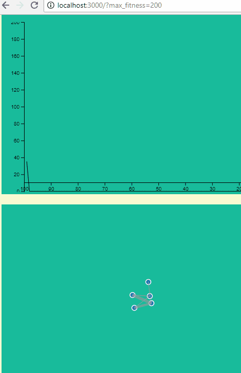

### Rust NEAT
[](https://github.com/TLmaK0/rustneat/actions/workflows/ci.yml)
[](https://gitter.im/rustneat/rustneat)

Implementation of **NeuroEvolution of Augmenting Topologies NEAT** http://nn.cs.utexas.edu/downloads/papers/stanley.ec02.pdf

This implementation uses a **CTRNN** (Continuous-Time Recurrent Neural Network) based on **On the Dynamics of Small Continuous-Time Recurrent Neural Network** (Beer, 1995) http://www.cs.uvm.edu/~jbongard/2014_CS206/Beer_CTRNNs.pdf

### CTRNN dynamics and time constant (τ)

Input neurons are sources: their value enters the neurons they connect to as
`w·x`. Every hidden and output neuron `j` follows

```text
τ_j · dy_j/dt = -y_j + Σ w_ij · σ(y_i + θ_i) + Σ w_kj · x_k
```

where `θ` is the neuron's bias. Each `Organism::activate` call integrates
`step_time` seconds in `round(step_time / dt)` steps of length about `dt`,
with **exponential Euler**: during a step of length `h` each neuron moves the
fraction `1 - e^(-h/τ)` of the way to its target,
`y ← y + (1 - e^(-h/τ))·(target - y)`. That fraction is in (0, 1], so the
integration is stable for any τ > 0 and has the fixed points of the ODE.

τ sets how fast a neuron follows its input; what matters is the ratio `dt/τ`:

- **Small τ** (τ ≤ dt/10): the neuron reaches its target in a single step and
  the network behaves as a discrete map. Suited to stateless problems such as
  XOR.
- **τ = dt**: the neuron moves about 63 % of the way each step.
- **Large τ** (τ of 10 to 100 times dt): neurons have inertia and the network
  keeps **temporal memory**, useful in control tasks such as Lunar Lander,
  where the agent integrates information over time.

**Propagation depth.** A change travels one connection per integration step,
so one `activate` call only sees inputs at most `round(step_time / dt)`
connections upstream; longer paths act on later calls. The CTRNN state
persists between calls until `Organism::reset_state`, so reset it before each
case when the cases are independent.

**Per-neuron τ.** τ is a gene: `Genome::tau(id)` / `Genome::set_tau(id, τ)`.
Neurons without a τ gene use the default `MutationConfig::tau`. τ only evolves
when `tau_mutation_rate` is above zero (it is zero by default); then each τ is
perturbed log-normally (`tau_gene_mutation_rate`, `tau_mutate_power`) and
clipped to `tau_range(min, max)`. `compatibility_tau_coefficient` adds τ
differences to the speciation distance.

All of these are `MutationConfig` settings, copied into every organism of the
population:

```rust
use rustneat::{MutationConfig, Population};

let config = MutationConfig::builder()
    .dt(0.01) // integration step, seconds
    .step_time(0.1) // simulated time per activate() call: 10 steps
    .tau(0.1) // default τ: neurons with memory
    .tau_mutation_rate(0.1) // let τ evolve per neuron...
    .tau_range(0.01, 1.0) // ...within this range
    .build();
let population = Population::create_population_initialized_with_config(150, 2, 1, config);
assert_eq!(population.size(), 150);
```

**Explicit Euler.** `Integrator::Euler` (`y ← y + (h/τ)·(target - y)`) is kept
to reproduce older results. It is only stable for `h/τ < 2` and is available
through the low-level `Ctrnn::with_integrator(Integrator::Euler)`;
`Organism::activate`, and so evolution, always uses exponential Euler.

## Telemetry Dashboard


```bash
cargo run --release --example simple_sample --features=telemetry
```

Then go to `http://localhost:3000` to see how the neural network evolves.



## Cart Pole


NEAT+CTRNN agent for the gymnasium CartPole-v1 environment (4 inputs, 1
output: push right above 0.5). It needs a Python with gymnasium:

```bash
pip install "gymnasium[classic-control]"
cargo run --release --example openai --features openai
```

## Lunar Lander

NEAT+CTRNN agent evolved to land on the OpenAI Gym LunarLander-v3 environment using discrete actions with independent threshold-based output control.


### Results
- **Verified average reward**: +70 (fitness 570 with +500 offset)
- **Peak reward**: +278 (fitness 778)
- **Solved threshold**: average reward +200

The agent uses 2 independent CTRNN outputs (main thruster, lateral direction) with lateral priority — a key insight for CTRNN control problems where argmax causes state lock-in.

### Run

```bash
cargo build --release --example openai_lunar_lander --features openai
./target/release/examples/openai_lunar_lander
```

### Test champion

```bash
cargo build --release --example test_champion --features openai
./target/release/examples/test_champion
```

Champions saved by older versions still load. A `champion.json` written before the per-neuron bias (#60) stores each gene with a fifth field, `is_bias`; that field is dropped and every bias loads as 0. Such a champion runs, but it does not behave as it did when it was saved: since #59 the outputs are `σ(y + θ)` (inputs are sources and are no longer integrated) and since #60 the bias is a real per-neuron bias instead of the old `is_bias` connection flag. Its saved fitness is therefore not meaningful any more; evolve it again with the current version to get a champion that reproduces its score.

## Install Rust

```bash
curl --proto '=https' --tlsv1.2 -sSf https://sh.rustup.rs | sh
source $HOME/.cargo/env
```

## Run tests

To speed up tests, run them with `--release`. The XOR test runs one seeded attempt of at most 500 generations (seed 1; set `RUSTNEAT_XOR_SEED` to try another) and checks that the champion solves XOR in all 24 orders of the patterns:

```bash
cargo test --release
```

## Sample usage

This README documents the code in this repository, which can differ from the
releases published on crates.io. To use it, depend on the repository:

```toml
[dependencies]
rustneat = { git = "https://github.com/TLmaK0/rustneat", branch = "develop" }
```

The Rust examples in this README are compiled and run as doc-tests by
`cargo test`, so they match the API of the code next to them.

Then use the library to implement XOR classification. `activate` keeps the
CTRNN state between calls (useful for control tasks, where one episode is many
calls); XOR is four independent cases, so the state is reset before each one:

```rust
use rustneat::{Environment, Organism, Population};

const PATTERNS: [([f64; 2], f64); 4] = [
    ([0f64, 0f64], 0f64),
    ([0f64, 1f64], 1f64),
    ([1f64, 0f64], 1f64),
    ([1f64, 1f64], 0f64),
];

struct XORClassification;

impl Environment for XORClassification {
    fn test(&self, organism: &mut Organism) -> f64 {
        let mut output = vec![0f64];
        let mut distance = 0f64;
        for (inputs, expected) in PATTERNS.iter() {
            organism.reset_state(); // each pattern starts from rest
            organism.activate(inputs.to_vec(), &mut output);
            distance += (expected - output[0]).powi(2);
        }
        16f64 / (1f64 + distance)
    }
}

fn main() {
    // 2 inputs connected directly to 1 output, no hidden neurons:
    // NEAT adds neurons and connections as it needs them.
    // `with_seed` makes the run reproducible; leave it out for a random one.
    let mut population = Population::create_population_initialized(150, 2, 1).with_seed(42);
    let environment = XORClassification;
    let mut champion: Option<Organism> = None;
    for _generation in 0..500 {
        population.evolve();
        // Err if the environment returns NaN or an infinite fitness.
        population
            .evaluate_in(&environment)
            .expect("the environment must return a finite fitness");
        champion = population
            .get_organisms()
            .into_iter()
            .find(|organism| organism.fitness > 15.5f64);
        if champion.is_some() {
            break;
        }
    }
    match champion {
        Some(champion) => println!("{:?}", champion.genome),
        None => println!("not solved within 500 generations"),
    }
}
```

The same program, with the champion's answers printed, is
`examples/simple_sample.rs`:

```bash
cargo run --release --example simple_sample
```

## Develop

Check style guidelines with:

```bash
rustup component add rustfmt-preview
cargo fmt
```

## References

- **NeuroEvolution of Augmenting Topologies NEAT** http://nn.cs.utexas.edu/downloads/papers/stanley.ec02.pdf
- **On the Dynamics of Small Continuous-Time Recurrent Neural Network** (Beer, 1995) http://www.cs.uvm.edu/~jbongard/2014_CS206/Beer_CTRNNs.pdf
- **An Investigation into the Dynamics of a Continuous Time Recurrent Neural Network Node** http://www.tinyblueplanet.com/easy/FCSReport.pdf

## Thanks

Thanks for the icon nerves by Delwar Hossain from the Noun Project
